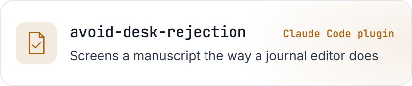
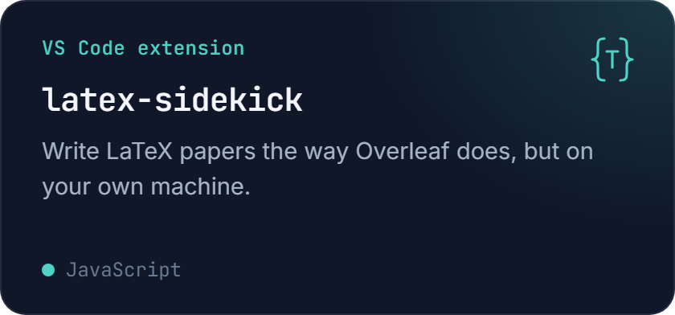
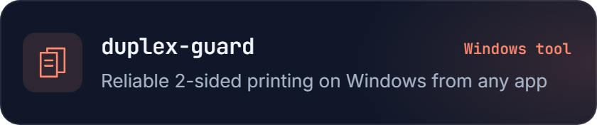
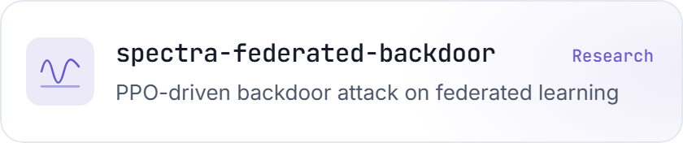

  
  
  
  

<h3 align="center">Publications</h3>

<!-- papers:start -->
<ol>
<li><a href="https://link.springer.com/article/10.1007/s11761-024-00404-z">A framework for checking and mitigating the security vulnerabilities of cloud service RESTful APIs</a> Service Oriented Computing and Applications 19 (3), 187-208 · 2025 · <a href="https://www.researchgate.net/profile/Md-Khan-115/publication/380975136_A_framework_for_checking_and_mitigating_the_security_vulnerabilities_of_cloud_service_RESTful_APIs/links/66ab1f344433ad480e8a1305/A-framework-for-checking-and-mitigating-the-security-vulnerabilities-of-cloud-service-RESTful-APIs.pdf">PDF</a></li>
<li><a href="https://telkomnika.uad.ac.id/index.php/TELKOMNIKA/article/view/13288">A survey on android security: development and deployment hindrance and best practices</a> TELKOMNIKA (Telecommunication Computing Electronics and Control) 18 (1), 485-499 · 2020 · <a href="https://telkomnika.uad.ac.id/index.php/TELKOMNIKA/article/viewFile/13288/7567">PDF</a></li>
<li><a href="https://ieeexplore.ieee.org/abstract/document/9298036/">Prediction of Dengue Infected Areas using A Novel Blockchain based Crowdsourcing Framework</a> 2020 11th IEEE Annual Ubiquitous Computing, Electronics &amp; Mobile Communication Conference (UEMCON) · 2020 · <a href="https://www.researchgate.net/profile/Md-Khan-115/publication/347978311_Prediction_of_Dengue_Infected_Areas_using_A_Novel_Blockchain_based_Crowdsourcing_Framework/links/601a2f16a6fdcc37a8fc2877/Prediction-of-Dengue-Infected-Areas-using-A-Novel-Blockchain-based-Crowdsourcing-Framework.pdf">PDF</a></li>
<li><a href="https://link.springer.com/chapter/10.1007/978-3-030-23502-4_19">A Hybrid Approach for Synchronizing Clocks in Distributed Systems</a> International Conference on Cloud Computing, 271-286 · 2019</li>
</ol>
<!-- papers:end -->

  
  
  
  
  

  For any query, please contact <a href="mailto:shohel.expo@gmail.com">shohel.expo@gmail.com</a> &nbsp;·&nbsp; <a href="mailto:shoheleas@gmail.com">shoheleas@gmail.com</a>

  

